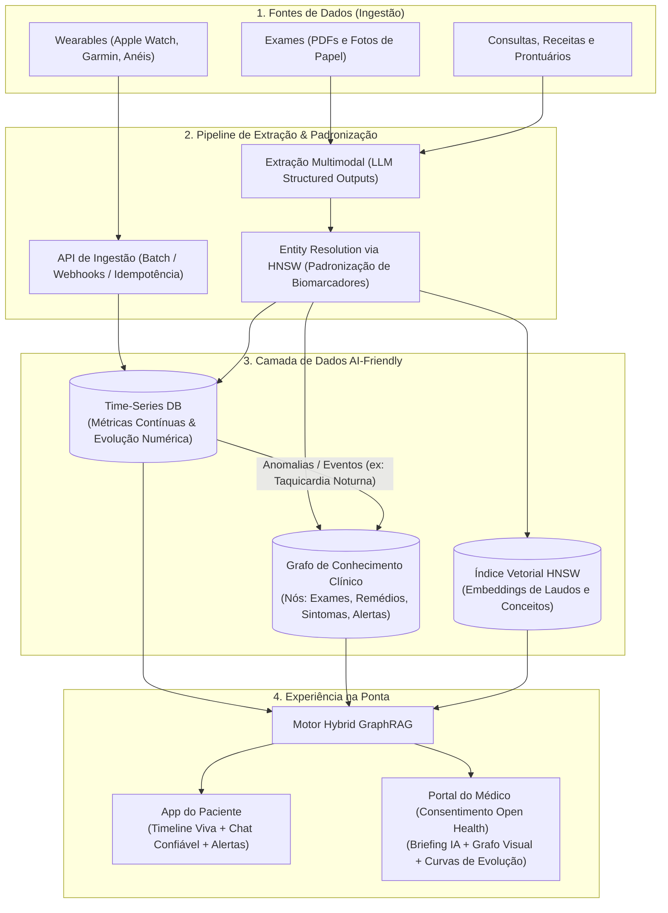

# Hub de Saúde Pessoal — Hackathon Gama House (Desafio Rivio)

Uma plataforma inteligente que unifica o histórico de saúde de cada pessoa — desde exames em papel de dez anos atrás até dados em tempo real gerados por wearables — estruturando o contexto clínico em uma arquitetura **Hybrid GraphRAG + Time-Series** para empoderar tanto o paciente quanto o médico.

Documentação da frente web do médico: [contexto do produto](PRODUCT.md), [experiência e carteira contínua](doctor-web-development-plan.md) e [plano de implementação](docs/doctor-web-implementation-plan.md). O [contrato backend](docs/doctor-backend-contract.md), com [OpenAPI](docs/contracts/doctor-api.v0.1.openapi.json), é um **rascunho temporário para planejar web + integração**, ainda não aprovado pelo backend; não representa endpoints existentes.

A aplicação do médico está em [`web/`](web/README.md). Consulte instalação, modos real/demo e checks no README da web, e os resultados e pendências no [registro da implementação](docs/doctor-web-delivery.md).

## Camada institucional — desenho de 13/11/2026

A decisão de residência é **híbrida por origem**: documentos enviados pelo paciente e seus registros estruturados compõem o cofre pessoal central; bases institucionais permanecem na origem e fornecem apenas recortes autorizados, processados temporariamente pelo hub. Os dados institucionais não alimentam uma cópia permanente, grafo ou índice vetorial compartilhado por padrão. **Blockchain está excluída.**

O [fluxo institucional](docs/institutional-access-flow.md) descreve fornecimento, extração, autorização, entrega e medição. A [decisão de residência](docs/institutional-data-residency.md) compara alternativas e define tratamento de cache, revogação e indisponibilidade. A [pesquisa institucional](docs/institutional-research.md), delegada ao `agy` com Gemini 3.8 Flash High, reúne fontes, atores, possíveis pagadores e hipóteses comerciais. Os termos estão no [glossário](GLOSSARY.md).

O desenho recomenda uma unidade de serviço por **episódio de acesso institucional**, reconhecida após entrega completa e confirmação autenticada do pacote clínico contratado. Cliques, polling, retries, erros e leituras de uma mesma entrega não multiplicam a cobrança. Acesso por QR anônimo e o registro de revisão já existente na web não são eventos de cobrança institucional.

Esta etapa entrega pesquisa e desenho, sem implementar backend, cobrança ou conectores de instituições. A disposição a pagar, o enquadramento jurídico, as regras comerciais e os contratos com fontes precisam de validação. O contrato médico `0.1-draft` permanece temporário, sem alteração de suas rotas ou promessa de integração real.

---

## O Problema

Na saúde privada, o histórico de cada pessoa fica fragmentado entre laboratórios, hospitais, planos de saúde e papel. 
- **Para o médico:** Vê apenas o que o paciente lembra de levar na consulta e não tem acesso estruturado aos sinais contínuos registrados por wearables (como indícios de fibrilação atrial, apneia do sono ou hipertensão), resultando em exames repetidos e decisões com informação incompleta.
- **Para o paciente:** Embora milhões de pessoas façam perguntas de saúde a IAs semanalmente, essas conversas ocorrem sem o contexto clínico real e atualizado da pessoa.

---

## A Visão da Solução

Nossa solução atua em duas frentes complementares: **engenharia de dados clínicos orientada a IA (AI-Friendly)** e **experiência nas duas pontas (Paciente e Médico)**.

1. **Estruturar o Histórico (Passado):** O usuário fotografa exames antigos em papel ou envia PDFs de laboratórios/consultas. A IA multimodal extrai, padroniza e estrutura cada resultado, medicamento, vacina e diagnóstico em uma linha do tempo única, comparando com as faixas de referência.
2. **Acompanhar o Presente (Tempo Real):** Dados de relógios, pulseiras e anéis inteligentes (batimentos, HRV, sono, atividade, SpO2) alimentam o mesmo histórico contínuo, detectando anomalias e indicando quando procurar um médico.
3. **Empoderar Paciente e Médico (Futuro):**
   - **Visão do Paciente:** Um assistente pessoal confiável que responde dúvidas com base no histórico real estruturado e envia alertas proativos.
   - **Visão do Médico (Estilo Open Finance):** Com o consentimento explícito do paciente (via link/QR Code temporário), o médico acessa um dashboard clínico consolidado com evolução temporal, grafo de correlações e um *briefing* pré-consulta cirúrgico, sem depender apenas da memória do paciente.

---

## Arquitetura Técnica

Para superar as limitações de um RAG tradicional (que perde relações de causa, efeito e temporalidade), projetamos uma arquitetura **Híbrida (Grafo de Conhecimento + Série Temporal + Busca Vetorial HNSW)**.

O fluxo de persistência abaixo descreve o **cofre pessoal**, com documentos fornecidos pelo paciente e fontes cuja conservação foi autorizada para esse fim. O acesso institucional sob demanda segue o [desenho específico](docs/institutional-access-flow.md); consultá-lo não autoriza incorporar os resultados à persistência longitudinal.

---

### 1. Integração com Wearables e Fontes de Dados

A ingestão de dados de dispositivos vestíveis e documentos médicos pode operar em 4 modalidades complementares:

- **Hubs do Sistema Operacional (Mobile):** Leitura local via **Apple HealthKit (iOS)** e **Health Connect (Android)** através de app mobile (ou exportação automatizada via webhook) enviando lotes (batches) para a API.
- **APIs Cloud-to-Cloud (OAuth2 + Webhooks):** Conexão direta do backend com nuvens de fabricantes (Garmin, Fitbit, Whoop, Oura, Polar, Withings).
- **Agregadores Unificados:** Uso de middlewares (como Terra API, Rook ou Vital) para receber payloads JSON/FHIR padronizados via Webhook.
- **Streaming Bluetooth (BLE) / Simulador em Tempo Real:** Leitura direta de perfis GATT (`0x180D` Heart Rate) ou simulação de eventos fisiológicos ao vivo (ex: episódios de fibrilação atrial ou apneia noturna) para demonstração em tempo real.

**Boas Práticas da API de Ingestão:**
- **Recebimento em Lote (Batch):** Suporte a milhares de leituras diárias por requisição.
- **Idempotência e Desduplicação:** Chave única composta (`user_id` + `metric_type` + `timestamp` + `source_device`) para evitar registros duplicados.
- **Extração Multimodal de Documentos:** Leitura de fotos de exames antigos ou PDFs transformando dados brutos em JSON tipado (data, laboratório, biomarcador, valor, unidade e faixa de referência).

---

### 2. Armazenamento Híbrido: Grafo + Time-Series + HNSW

#### A. Camada de Série Temporal (O "Presente Contínuo" e Evolução)
- **O que armazena:** Leituras de alta frequência dos wearables (BPM, HRV, estágios do sono, passos, SpO2) e a série histórica numérica de biomarcadores laboratoriais (ex: Glicose, LDL, TSH, Ferritina ao longo de 10 anos).
- **Conexão com o Grafo:** Um *worker* analisa as séries temporais e, ao detectar tendências ou anomalias (ex: queda brusca de sono profundo ou 3 episódios de taquicardia noturna), gera automaticamente um nó de evento no Grafo: `(AlertaWearable: Taquicardia Noturna)`.

#### B. Camada de Grafo de Conhecimento Clínico (O Contexto Relacional)
- **Nós (`Nodes`):** `Paciente`, `ExameLaboratorial`, `Biomarcador`, `Sintoma`, `Medicamento`, `Condicao`, `AlertaWearable`, `ConsultaMedica`.
- **Arestas (`Edges`):**
  - `(Paciente) -[TOMA {desde: '2026-10-01'}]-> (Medicamento: Levotiroxina)`
  - `(Exame: Hemograma) -[MEDIU {valor: 6.2, status: 'Acima da Referência'}]-> (Biomarcador: Hemoglobina Glicada)`
  - `(AlertaWearable: Queda de HRV / Sono Ruim) -[CORRELACIONADO_COM]-> (Condicao / Medicamento)`

#### C. O Papel do HNSW (*Hierarchical Navigable Small World*)
O algoritmo **HNSW** atua como um índice vetorial em múltiplas camadas (busca aproximada de vizinhos mais próximos em milissegundos) e resolve 3 desafios críticos na nossa arquitetura:

1. **Padronização na Ingestão (*Entity Resolution* / De-duplicação):**
   - Exames de diferentes épocas e laboratórios usam nomes distintos para a mesma métrica (ex: *"Glicemia de Jejum"*, *"Glicose Plasmática"*, *"Açúcar no sangue"*).
   - Na ingestão, a busca via HNSW mapeia instantaneamente o termo extraído para o nó canônico (`Biomarcador: Glicose`) já existente no grafo, mantendo a linha do tempo coesa.
2. **Ponto de Entrada Semântico no Grafo (*Hybrid GraphRAG*):**
   - Quando o paciente faz uma pergunta usando linguagem leiga (ex: *"Sinto uma batedeira no peito depois de tomar meu remédio"*), o HNSW localiza em milissegundos os nós clinicamente equivalentes no grafo (`Sintoma: Palpitação`, `AlertaWearable: Taquicardia`).
   - A partir desses nós iniciais, o sistema navega pelas **arestas do Grafo** (1 a 2 saltos) para recuperar medicamentos ativos, exames recentes e curvas da série temporal.
3. **Busca em Laudos Descritivos:**
   - Indexação de trechos (*chunks*) de exames textuais complexos (ressonâncias, ecocardiogramas, evoluções médicas) para recuperação semântica rápida pelo médico.

---

## Experiência nas Duas Pontas

### Visão do Paciente
- **Linha do Tempo Unificada:** Exames antigos estruturados lado a lado com os sinais vitais atuais dos wearables e faixas de referência.
- **Chat de Saúde Confiável (GraphRAG):** Respostas embasadas estritamente nos dados cruzados do próprio paciente (ex: relacionar fadiga relatada hoje com queda de sono profundo no relógio + ferritina baixa no exame de 3 meses atrás).
- **Alertas Proativos:** Identificação de padrões de risco (como ritmo cardíaco irregular ou sinais de apneia) com recomendação fundamentada para buscar atendimento médico.

### Visão do Médico ("Open Health" + Copiloto Clínico)
- **Consentimento estilo Open Finance:** O paciente compartilha o acesso ao seu hub de saúde com o médico de forma segura e auditável.
- **Dashboard Consolidado de 1 Página:**
  - **Briefing Pré-Consulta por IA:** Resumo executivo dos pontos críticos, anomalias recentes do wearable e alterações laboratoriais relevantes.
  - **Visualização de Evolução Cruzada:** Gráficos temporais de biomarcadores e sinais vitais sobrepostos ao início/alteração de medicamentos.
  - **Grafo Clínico Interativo:** Visão clara das relações entre queixas do paciente, histórico de exames, medicações em uso e alertas contínuos dos dispositivos.

---

## Stack Sugerida para o Protótipo / Live Demo

- **Frontend:** Next.js + Tailwind CSS + Recharts (séries temporais com faixas de referência) + `react-force-graph` ou `@xyflow/react` (visualização interativa do Grafo de Saúde).
- **Banco de Dados Unificado:** PostgreSQL (Supabase) utilizando:
  - Tabelas otimizadas para **Time-Series** (histórico de wearables e resultados numéricos).
  - Tabelas de `nodes` e `edges` (ou Neo4j AuraDB) para o **Grafo de Conhecimento Clínico**.
  - Extensão `pgvector` com índice **`USING hnsw (embedding vector_cosine_ops)`** para busca semântica ultrarrápida e padronização de entidades.
- **IA & Extração Multimodal:** Gemini API (Structured Outputs para leitura de PDFs/fotos de exames e geração de respostas via GraphRAG).
