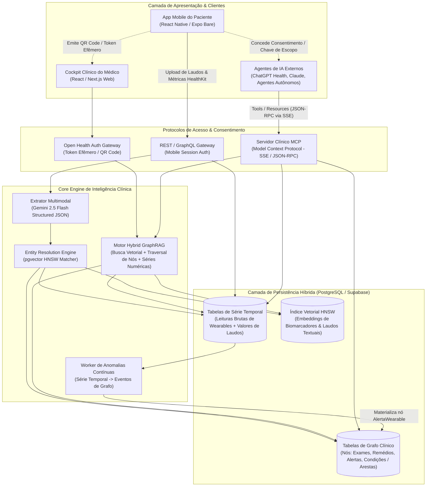
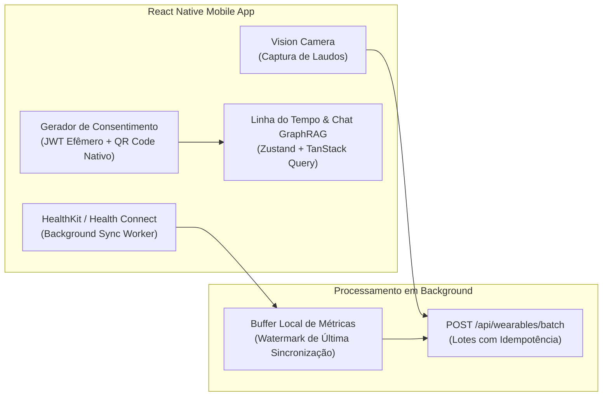
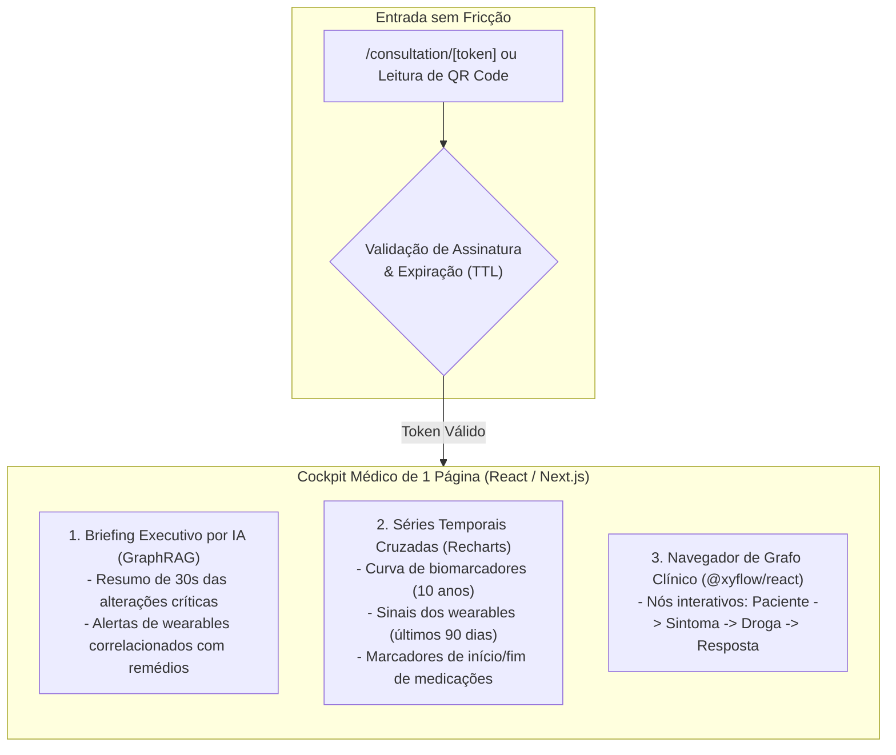
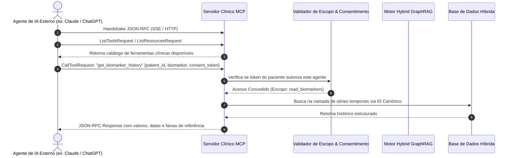

# Plano Técnico de Arquitetura da Solução: Hub de Saúde Pessoal

Definição arquitetural incorporando o ecossistema multiplataforma (**React Native** no mobile do paciente, **React/Next.js** na web do médico) e a camada de interoperabilidade com **Model Context Protocol (MCP)** para agentes de IA externos.

---

## 1. Visão Geral da Topologia do Sistema



---

## 2. Stack Tecnológica Detalhada

| Camada | Tecnologia | Justificativa Técnica |
| :--- | :--- | :--- |
| **Mobile (Paciente)** | **React Native** (Expo Bare Workflow) | Acesso direto a APIs nativas do dispositivo: **Apple HealthKit** (iOS) e **Health Connect** (Android), `react-native-vision-camera` para captura rápida de laudos, e armazenamento local seguro (`expo-secure-store`). |
| **Web (Médico)** | **React** + **Next.js** (App Router) | Zero fricção para o médico no consultório (não requer instalação). Renderização server-side ultra-rápida, `@xyflow/react` para visualização interativa do grafo clínico e `Recharts` para séries temporais cruzadas. |
| **Interoperabilidade de IA** | **Servidor MCP** (`@modelcontextprotocol/sdk`) | Expõe ferramentas e recursos clínicos padronizados sob transporte SSE/HTTP com autenticação por token de consentimento do paciente para agentes (ChatGPT, Claude, copilotos hospitalares). |
| **Backend & APIs** | **Node.js (TypeScript) / Fastify** | Performance de I/O assíncrono para ingestão de séries temporais em lote e orquestração do pipeline GraphRAG. |
| **Banco de Dados Híbrido** | **PostgreSQL (Supabase)** | Unificação arquitetural: `pgvector` com índice **HNSW** para busca semântica, tabelas relacionais de nós/arestas para o **Grafo**, e particionamento temporal para séries contínuas. |
| **IA & Extração** | **Gemini API** | Extração multimodal estruturada (`response_format` JSON schema) de fotos e PDFs com alta tolerância a ruído e rotação. |

---

## 3. POV 1: App Mobile do Usuário Comum (React Native)

O app mobile atua como o **coletor central de dados** e a **carteira de consentimento de saúde** do usuário.



### Componentes Nativos Essenciais:
1. **Background Health Sync (`react-native-health` / `react-native-health-connect`):**
   - Agendamento de sync periódico de passos, batimento em repouso, variabilidade de frequência cardíaca (HRV), saturação de O2 e estágios do sono.
   - Envio em lotes compactados contendo chave de idempotência (`user_id + device_id + metric + timestamp`).
2. **Scanner e Captura Multimodal:**
   - Detecção de bordas de papel e compressão de imagem antes do upload direto para o pipeline de extração.
3. **Módulo de Emissão de Consentimento:**
   - Geração de assinaturas temporárias (Open Health Token) com escopo e duração limitados.
   - Geração de QR Code via biblioteca nativa para leitura física imediata no consultório.
   - Dashboard de revogação de acessos: exibe quais médicos e agentes externos possuem permissões ativas.

---

## 4. POV 2: Cockpit Clínico do Médico (React / Next.js Web)

Aplicação web responsiva e de alta densidade de informação projetada para o computador do consultório médico, eliminando etapas de cadastro manual.



### Componentes de Interface do Médico:
1. **Zero-Login Gateway:**
   - Middleware no Next.js intercepta o parâmetro `[token]`, valida no backend a assinatura criptográfica e autoriza a sessão temporária na memória do navegador.
2. **Briefing Clínico Sintético:**
   - Renderiza diagnósticos prováveis, alterações laboratoriais e incongruências temporais (ex: taquicardia noturna após introdução de novo fármaco) geradas pelo motor GraphRAG.
3. **Matriz de Correlação Temporal:**
   - Sobreposição de gráficos de linhas com zoom sincronizado, permitindo ao médico correlacionar eventos agudos dos wearables com laudos laboratoriais crônicos.

---

## 5. O Servidor MCP: Interoperabilidade para Agentes de IA Externos

O **Model Context Protocol (MCP)** é a camada que permite a ecossistemas externos de agentes (como o ChatGPT Health, Claude Desktop, ou copilotos hospitalares proprietários) consultarem os dados de seus respectivos pacientes de forma controlada, segura e padronizada.



### Especificação de Ferramentas (`Tools`) do Servidor MCP:

O servidor MCP expõe as seguintes ferramentas utilitárias tipadas para os LLMs externos:

#### 1. `get_patient_clinical_briefing`
* **Descrição:** Retorna a síntese clínica gerada pelo GraphRAG contendo diagnósticos ativos, medicações em uso e alertas críticos.
* **Argumentos:**
  ```json
  {
    "patient_id": "uuid",
    "consent_token": "string"
  }
  ```

#### 2. `get_biomarker_history`
* **Descrição:** Retorna a série histórica de um biomarcador específico (com padronização canônica) contendo valores numéricos, datas e faixas de referência.
* **Argumentos:**
  ```json
  {
    "patient_id": "uuid",
    "biomarker_query": "string",
    "start_date": "ISO8601 string (opcional)",
    "consent_token": "string"
  }
  ```

#### 3. `get_wearable_anomalies`
* **Descrição:** Consulta anomalias fisiológicas detectadas pelos vestíveis (arritmias, quedas de oxigenação, desvios extremos de sono ou HRV) em uma janela temporal.
* **Argumentos:**
  ```json
  {
    "patient_id": "uuid",
    "days_back": 30,
    "metric_filter": "heart_rate | hrv | sleep | spo2 (opcional)",
    "consent_token": "string"
  }
  ```

#### 4. `query_clinical_knowledge_graph`
* **Descrição:** Executa uma travessia semântica nas arestas do grafo de conhecimento a partir de um sintoma, medicamento ou laudo para descobrir conexões clínicas indiretas.
* **Argumentos:**
  ```json
  {
    "patient_id": "uuid",
    "source_entity": "string",
    "max_hops": 2,
    "consent_token": "string"
  }
  ```

### Especificação de Recursos (`Resources`) do Servidor MCP:
* `health://patients/{patient_id}/summary`: Retorna o documento Markdown estruturado contendo o perfil de saúde consolidado.
* `health://patients/{patient_id}/timeline`: Retorna a linha do tempo canônica em formato JSON-LD / FHIR-lite.

---

## 6. Fluxo de Dados End-to-End Integrado

```
[Paciente: React Native] 
       │ 
       ├─► (Foto/PDF) ──► Gemini 2.5 ──► HNSW Matcher ──► PostgreSQL (Nós & Séries)
       │                                                         ▲
       └─► (HealthKit) ─► Time-Series API ──► Anomaly Worker ────┤
                                                                 │
                                                       Hybrid GraphRAG
                                                                 │
                   ┌─────────────────────────────────────────────┴────────────────────────────┐
                   ▼                                                                          ▼
      [Médico: React Web Dashboard]                                              [Agentes IA: MCP Server]
      - Briefing Clínico em 30s                                                  - Tools: get_biomarker_history
      - Gráficos Cruzados Recharts                                               - Tools: get_wearable_anomalies
      - Navegação de Grafo @xyflow                                               - Tools: query_clinical_graph
```
