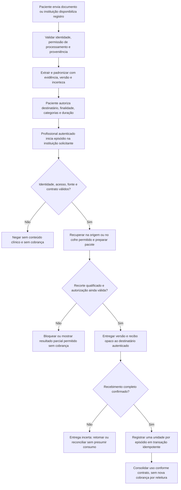

# Fluxo institucional e unidade de consumo

Data: **13/11/2026**. Estado: **desenho recomendado; não implementado nem contratado**.

Este desenho estende a proposta do hub para atendimento entre instituições. Não altera a web, o [contrato médico temporário v0.1](doctor-backend-contract.md), seu OpenAPI, o acesso pontual por QR/link ou a revisão de novidades. Backend, conectores, identidade institucional e faturamento reais ainda precisam ser construídos e alinhados com seus responsáveis. Não há blockchain.

Complementos: [pesquisa de instituições e pagadores](institutional-research.md) e [residência de dados](institutional-data-residency.md). Regras econômicas abaixo são uma hipótese de produto para validar com compradores; a pesquisa não comprova disposição de pagar.

## 1. Decisão recomendada

Oferecer um **pacote de contexto clínico assistencial** para um atendimento identificado. A instituição que solicita o pacote seria a contratante/pagadora. Ela paga pelo processamento, organização e entrega do contexto autorizado; o pagamento não cria autorização para acessar dados. O paciente não paga por conceder ou revogar acesso. Não prever remuneração automática à instituição fornecedora por registro neste primeiro desenho.

Uma unidade cobrável corresponde ao **primeiro recebimento confirmado de um pacote clínico qualificado em um episódio de acesso institucional**. Esse episódio liga instituição, paciente, atendimento e finalidade assistencial. Abrir telas, clicar em evidências ou fazer chamadas HTTP não representa uma nova unidade.

Para qualificar o produto inicial, o pacote precisa conter:

- Pelo menos uma evidência clínica útil e autorizada, de outra instituição ou fornecida pelo paciente, com origem e versão; a consulta isolada aos próprios dados da solicitante não basta.
- Resultados estruturados e organização temporal, preservando datas, unidades, referências, incertezas e cobertura efetivamente disponível.
- Síntese fundamentada cujas afirmações apontem para evidências permitidas, com fatos, associações e hipóteses distinguidos.
- Manifesto do recorte contratado: categorias, intervalo, fontes consultadas permitidas, limitações e versão do pacote. Toda referência de evidência deve resolver dentro desse conjunto autorizado.

Um histórico longitudinal incompleto pode qualificar se o recorte contratado foi atendido e sua cobertura estiver explícita. O produto não exige que todas as instituições do país respondam. Se uma fonte ou etapa **necessária ao recorte acordado** falhar, o pacote é parcial e não qualifica para cobrança. A definição de recorte e requisitos mínimos é fixa no início da intenção; não pode ser reduzida silenciosamente após uma falha para produzir uma unidade cobrável.

O médico pode continuar usando dados básicos autorizados quando o briefing falhar; esse resultado é uma entrega parcial gratuita deste produto, não uma síntese inventada nem uma mudança implícita do produto cobrado. Custos de IA e tentativas sem entrega qualificada pertencem à operação da plataforma.

## 2. Vocabulário para evitar cobrança por clique

| Conceito | Significado neste desenho |
| --- | --- |
| Consulta clínica | O atendimento prestado por um profissional. Não é uma chamada de sistema. |
| Requisição HTTP | Uma tentativa técnica de preparar, buscar ou confirmar um resultado. Pode haver muitas para um só atendimento. |
| Concessão de acesso | Permissão com destinatário, finalidade assistencial, categorias, duração e condições da fonte. Não é compra nem unidade consumida. |
| Referência de atendimento | Identificador estável do atendimento na instituição solicitante, ligado ao paciente e validado no backend. Não nasce a cada aba ou refresh. |
| Episódio de acesso institucional | Unidade de uso ligada à instituição, ao paciente, ao atendimento e à finalidade. Possui produto e condições definidos no servidor. |
| Pacote clínico | Recorte autorizado de contexto, com fontes, versões e cobertura, entregue naquele episódio. Pode expirar, ser corrigido ou regenerado. |
| Evento de uso | Registro mínimo e auditável de uma ação ou resultado do episódio. Pode representar tentativa, falha ou entrega e não é necessariamente cobrável. |
| Evento de cobrança | Registro único que reconhece uma unidade após a primeira confirmação válida de pacote clínico qualificado. Não contém o laudo ou briefing. |
| Fatura | Consolidação comercial dos eventos de cobrança, conforme contrato e eventual franquia. Registrar um evento não executa pagamento. |

O episódio de acesso institucional vem de um atendimento reconhecido pela instituição, por identificador estável e validado, não de um UUID arbitrário enviado pelo navegador. Se não houver integração ou processo confiável para identificá-lo, o piloto permanece **sem faturamento automático** até definir essa operação. Não inventar uma janela diária para substituir atendimento sem acordo comercial. Encerrar e reabrir uma aba ou sessão não cria outro episódio; um novo atendimento real pode criar outro, segundo a política contratada.

No restante do documento, "episódio" abrevia episódio de acesso institucional. Termos canônicos ficam no [glossário do projeto](../GLOSSARY.md).

## 3. Fluxo proposto

### Fornecimento e processamento

1. Upload do paciente exige autorização de processamento antes da extração. O envio não equivale a compartilhar com toda a rede. Uma instituição só fornece registros dentro do acesso efetivamente autorizado na origem; não se solicita a cópia de sua base inteira.
2. Vincular a identidade do paciente a cada fonte por processo verificável. Nome semelhante, proximidade vetorial ou simples coincidência de campo não autorizam mesclar prontuários. Correspondência ambígua bloqueia a incorporação e pede resolução explícita.
3. Preservar o registro original conforme a política de residência. Extrair valores, unidades, referências, datas e fonte; guardar também o trecho/documento de suporte e a versão quando permitido. Unidade desconhecida ou leitura duvidosa fica marcada para conferência; não completar um número por inferência. Valores incertos ou não comparáveis não alimentam gráficos combinados, tendências ou insights até sua validação.
4. Padronização semântica pode sugerir o conceito, mas precisa respeitar compatibilidade de medida, método e unidade. Similaridade de nomes ou embeddings não prova equivalência clínica e não basta para unir resultados diferentes. Correção gera versão que substitui a anterior e invalida os derivados afetados.

O conteúdo de documentos e respostas de fontes é dado não confiável para fins de instrução ao modelo: textos embutidos não podem mudar permissões, acionar ferramentas, seguir links arbitrários ou determinar destinatários. A extração é validada contra o formato esperado; a autorização continua sendo decisão determinística do backend.

### Autorização e preparação

5. O paciente aprova destinatário e escopos. Para o novo produto B2B, é preciso modelar também a instituição solicitante e o contexto assistencial; o grant médico v0.1 não é promovido automaticamente a autorização institucional.
6. O backend autentica profissional e instituição, confirma o vínculo entre ambos e o episódio do paciente. Instituição pagadora e finalidade vêm do contexto confiável e do contrato, não de um `institutionId` ou `payerId` escolhido livremente pelo cliente. Uma operadora não recebe esse pacote assistencial apenas porque custeia o serviço.
7. A leitura exige a interseção das permissões do paciente, do profissional, da instituição e da fonte, além das condições de tratamento validadas para a operação. Contrato comercial válido é requisito de faturamento; ele não substitui nenhum controle de acesso. Casos diferentes do consentimento planejado exigem desenho e validação próprios; não criar exceção silenciosa.
8. Preparar o pacote só com as origens permitidas. Exibir `empty`, `not_shared` e `unavailable` como situações diferentes, sem contar registros ocultos. Uma fonte indisponível não significa ausência de histórico. A data clínica, a versão e a última confirmação da fonte não se confundem com a hora de geração da IA.
9. Revalidar permissões e revisões antes de liberar cada versão e cada leitura. Se mudaram durante extração/geração, descartar ou refazer a projeção sob as permissões atuais. O modelo não decide acesso. Uma resposta iniciada antes de revogação não pode repor conteúdo bloqueado no cliente. A revogação tem um ponto de corte autoritativo no backend: novas liberações e confirmações são ordenadas em relação a ele. Não se promete recolher bytes já enviados nem revogação instantânea distribuída. Mudanças na origem só são conhecidas por comunicação da fonte ou validação atual; se a condição da fonte não puder ser confirmada nos termos acordados, bloquear entrega e nova cobrança.

### Entrega, confirmação e uso

10. Entregar um pacote finito, versionado e com fechamento de referências. Para a primeira implementação, preferir esse resultado completo a um stream de texto que possa ser interrompido. O consumidor valida o conjunto antes de confirmar recebimento.
11. A instituição confirma, por seu consumidor autenticado, `packageId`, versão e recibo opaco vinculado à entrega. O recibo só é disponibilizado com o final do pacote e não concede nova leitura clínica. O backend revalida a identidade individual do profissional, seu vínculo institucional, permissões atuais do paciente e da fonte, integridade, qualificação e validade do recibo; não aceita confirmação de outra instituição ou outro paciente.
12. Numa mesma transação de banco, registrar a confirmação como evento de uso e inserir, se ainda não existir, o evento de cobrança do episódio de acesso institucional. Usar uma restrição única do equivalente a `(instituição_solicitante, paciente, referência_de_atendimento, finalidade_assistencial)` para o episódio e uma restrição única de evento de cobrança por episódio; `packageId`, revisão de dados, modelo de IA e número de tentativa **não** pertencem à chave. Finalidade e produto vêm do servidor: alterar escopos, plano ou o rótulo do produto não cria automaticamente outra unidade. O contrato/pagador/preço aplicável é fixado por referência no episódio. Essa regra favorece previsibilidade e evita duplicidade; uma futura venda de produto adicional exige política comercial separada e explícita, sem reclassificar o mesmo consumo por tentativa.
13. Retornar o identificador do evento de cobrança registrado. Se essa resposta se perder, repetir a confirmação com a mesma intenção devolve o mesmo resultado; não executar nova cobrança. Faturamento consome esse identificador de modo idempotente, com reconciliação de eventos pendentes antes de emitir uma fatura. Um ajuste ou estorno é novo registro vinculado ao original, não apagamento da trilha.

Gravar `HTTP 200`, terminar de escrever no socket ou concluir uma geração de IA **não prova recebimento completo**. O sinal contratado é a confirmação autenticada do consumidor; ela não prova que um médico leu ou utilizou o conteúdo e não deve ser descrita assim. Há confiança na implementação do destinatário: homologar esse consumidor e auditar as confirmações faz parte da integração comercial.

Não se promete entrega exatamente uma vez através da rede. Pode haver entrega sem confirmação, confirmação cuja resposta se perdeu ou processamento repetido. A garantia proposta é **no máximo um evento de cobrança por episódio**, com recebimentos incertos ainda sem cobrança e consulta/repetição idempotente da confirmação para reconciliação.

Um destinatário pode omitir a confirmação apesar de receber conteúdo; o transporte não elimina essa fraude. Homologar o consumidor, limitar operacionalmente entregas sem confirmação, acompanhar taxas anormais por instituição e prever reconciliação/contestação no contrato. Não faturar automaticamente tentativas sem confirmação como solução para esse risco; uma política comercial diferente precisa ser negociada antes do uso.

Se o acesso for revogado ou expirar antes de uma confirmação ainda não registrada, não criar nova unidade; o resultado fica sem cobrança até resolução permitida, sem reabrir o conteúdo. Repetição de uma confirmação já registrada retorna somente o estado administrativo mínimo, sem restaurar acesso clínico. Revogação posterior não apaga o evento legítimo já confirmado nem permite cobrar novamente.

A ordem entre confirmação e revogação conhecidas é serializada no backend, por revisão de autorização verificada dentro da transação local. A checagem na instituição de origem não é uma transação distribuída: exigir comprovação vigente da fonte, nos limites de validade acordados, e revalidar seu estado antes da entrega e da confirmação. Uma mudança remota ainda não comunicada pode não ser conhecida; esse limite precisa constar da integração. Não presumir autorização indefinida porque um cache ainda contém o resultado.

## 4. Residência e validade no fluxo

O [desenho de residência](institutional-data-residency.md) mantém uploads do paciente em seu cofre e originais institucionais na origem. Conteúdo institucional e seus derivados têm cache por contexto, com limite inicial proposto de 15 minutos desde a obtenção/materialização e sempre limitado pelas permissões e pela validade da fonte. Refresh ou confirmação não renovam esse prazo. Esse prazo não cria validade para acesso nem define o episódio comercial.

O mesmo episódio pode precisar regenerar seu pacote depois da expiração do cache, de uma correção ou da chegada de novos resultados. Havendo acesso válido, isso não gera segunda unidade. Cache não atravessa instituições. Após revogação ou perda de autorização da fonte, impedir novas leituras e invalidar os derivados afetados. A retenção de conteúdo no prontuário da destinatária, quando expressamente permitida, é uma decisão distinta; receber um pacote não confere acesso permanente ou permissão de redistribuição.

## 5. Módulo profundo recomendado

Um **módulo de contexto institucional**, no backend central, concentra a complexidade. Sua interface conceitual inicial tem três operações:

| Operação conceitual | Entrada confiável e comportamento |
| --- | --- |
| `prepareContext` | Recebe o ator institucional autenticado, o episódio validado e uma chave de intenção; valida acesso, recupera fontes permitidas e devolve pacote qualificado, estado parcial ou erro. Repetição da mesma intenção não cria episódio ou unidade. |
| `readContext` | Recebe o contexto autenticado e a referência do pacote; revalida acesso e validade para entregar a versão ou seu estado. Pode servir à retomada após timeout; nunca cobra por chamada. |
| `confirmReceipt` | Recebe a confirmação do consumidor e seu recibo; registra uma unidade idempotente e retorna o estado administrativo. A mesma operação pode ser repetida para reconciliar a resposta perdida. |

Esses nomes não são rotas existentes nem uma extensão do OpenAPI v0.1. A interface inclui os invariantes, expiração, distinção entre parcial/qualificado, falhas recuperáveis e idempotência; a implementação esconde extração, recuperação, filtragem de projeções e medição. Os adapters de fontes variam por instituição. Não fazer o frontend reunir dados de instituições nem decidir o que cobrar.

Internamente, uma preparação pode passar por `preparing`, `ready`, `partial`, `blocked` ou `unavailable`; uma entrega permanece `unconfirmed` até confirmação válida, passando a `confirmed`. Expiração do conteúdo e estado da unidade são eixos distintos: uma unidade confirmada não torna o pacote acessível depois de expirado.

O evento de uso guarda apenas identificadores internos necessários, referência do episódio/pacote/versão, instante e resultado da ação. O evento de cobrança acrescenta referência do contrato, horário de confirmação e estado administrativo. Não guardar texto de exame, diagnóstico, pergunta, prompt, token de acesso, recibo secreto ou síntese na medição, na fatura ou nos logs de suporte. Acesso aos metadados e retenção seguem a política específica da [residência](institutional-data-residency.md), sem oferecer consulta clínica por meio da trilha financeira.

## 6. Cenários mínimos para a implementação futura

Esta matriz define critérios para testes de integração quando o backend existir. Não são testes executados nem evidência de implementação.

| Cenário | Resultado esperado | Nova unidade? |
| --- | --- | --- |
| Instituição autenticada recebe e confirma pacote qualificado pela primeira vez | Confirmação e evento registrados atomicamente. | Sim, uma. |
| Duas abas, dois profissionais permitidos da mesma instituição ou polling no mesmo episódio | Leituras reautorizadas; mesma chave de unidade. | Não. |
| Timeout ao preparar ou buscar | Repetir a mesma intenção, sem abrir outro episódio. | Não, até confirmação. |
| Timeout após confirmação já commitada | Repetição recupera o evento existente. | Não. |
| Duas confirmações concorrentes ou novas chaves técnicas para a mesma unidade | Restrição única impede duplicidade; ambas resolvem para a mesma unidade. | No máximo uma. |
| Chave de intenção reutilizada com outro paciente/episódio/recorte | Conflito explícito; não reinterpretar a intenção. | Não. |
| Stream interrompido ou destinatário não confirma | Conteúdo recebido é incerto; retomar ou reconciliar, sem presumir entrega. | Não. |
| HTTP 200 com pacote vazio, sem evidência externa/paciente ou sem referências resolvíveis | Resultado não qualificado; registrar qualidade/falha sem faturar. | Não. |
| Fonte exigida offline ou briefing falha | Seções básicas permitidas continuam úteis e identificadas como parciais; tentar novamente na mesma intenção. | Não enquanto parcial. |
| Outra fonte opcional não tem registros | Declarar a cobertura; pode qualificar se o recorte acordado e o mínimo foram atendidos. | Uma apenas se completo e confirmado. |
| Revogação durante geração ou antes da entrega | Revalidar e bloquear/refazer projeção; sem pacote antigo liberado. | Não. |
| Revogação entre entrega e confirmação ainda não registrada | Não registrar nova unidade; não usar recibo como permissão clínica. | Não. |
| Revogação depois de confirmação válida | Bloquear novas leituras; preservar só trilha administrativa permitida. | Não; unidade anterior permanece. |
| Nova versão, correção ou cache expirado no mesmo episódio | Regenerar somente com acesso atual; invalidar pacote anterior quando necessário. | Não há segunda unidade. |
| Outro atendimento real, validado, posterior | Nova concessão/contexto quando necessário e nova qualificação/entrega. | Pode haver uma nova unidade. |
| Outra instituição tenta usar o pacote/recibo | Negar, sem revelar conteúdo, cobertura ou existência de paciente alheio. | Não. |
| Identidade de paciente ambígua entre fontes | Bloquear junção e encaminhar conferência; não entregar prontuário combinado. | Não. |
| Só há QR/link pontual anônimo do fluxo atual | Preservar o comportamento v0.1; não assumir identidade institucional nem contrato. | Não. |
| Médico conclui a revisão de novidades existente | Atualizar apenas seu marcador de revisão. | Não. |

## 7. Como observar o valor da inteligência

No piloto, medir separadamente **qualidade técnica**, **utilidade assistencial percebida** e **consumo comercial**. Um pacote faturável não comprova benefício clínico.

- Conferir extração contra um conjunto autorizado de referência: erro em valor/unidade/data, campo ilegível sinalizado, junção indevida de paciente e necessidade de correção humana.
- Medir proporção de afirmações da síntese com evidência resolvível e permitida, omissões de informações presentes, tratamento de conflito entre fontes e distinção de fato/associação/hipótese. Campos sem suporte ficam ausentes ou explícitos; a IA não recebe meta de completar lacunas.
- Observar tempo de preparação, fontes indisponíveis, pacotes parciais, idade das informações e confirmações perdidas; usar isso para melhorar operação, sem cobrar por tentativa.
- Pedir ao profissional avaliação de utilidade do resumo e tempo de busca antes/depois no piloto. Redução de repetição de exames ou melhora de desfecho permanece hipótese até estudo apropriado; não inferir a partir de cliques.
- Auditar duplicidade de unidade e divergência entre recibo, evento e fatura, usando dados administrativos mínimos. A meta de integridade é zero cobrança por acesso negado, pacote não qualificado ou tentativa repetida.

Não automatizar diagnóstico, prescrição ou decisão de cobertura. Informações clínicas do piloto e correções não entram em treinamento geral de modelos ou análise financeira como efeito implícito da integração.

## 8. O que precisa ser acordado antes de implementar cobrança

1. Comprador inicial, produto mínimo, recorte e preço/franquia, com o responsável comercial; não há disposição de pagar validada.
2. Como identificar e homologar instituição, profissional e episódio; nenhum provedor foi escolhido.
3. Condições de fornecimento, tratamento, destinatários e eventual retenção no prontuário da solicitante; a proposta de consentimento não equivale a validação jurídica geral.
4. Protocolo de confirmação, prazo de validade do recibo, limite do episódio, tratamento de contestação e reconciliação com faturamento.
5. Integração real com as fontes e backend, usando a matriz acima como critérios. Até lá, medição demonstrativa ou piloto sem cobrança, claramente separados de faturamento real.
